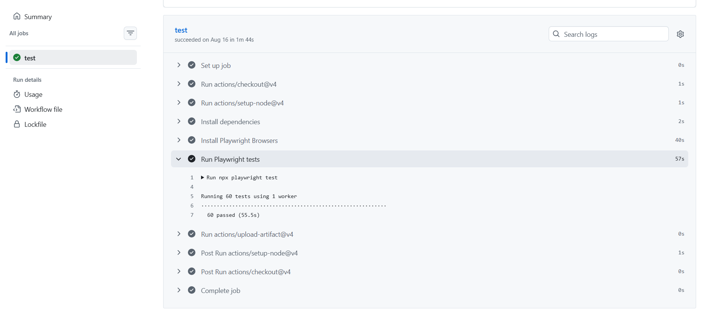

# SauceDemo Test Automation with Playwright

An independent QA portfolio project testing **login behavior and a complete purchase journey** on [SauceDemo](https://www.saucedemo.com/), using **Playwright Test, JavaScript, and the Page Object Model**.

I built this project while learning Playwright independently, building on my professional QA and automation experience. It demonstrates scenario selection, reusable page interactions, UI assertions, and automated execution through GitHub Actions.

## Test coverage

The suite contains **21 test cases**: **20 login cases and 1 complete checkout journey**. All are configured to run on **Chromium, Firefox, and WebKit**, giving **63 test executions before retries** when running the full suite.

| Area | Coverage | Cases |
| --- | --- | --- |
| Standard login | Valid credentials navigate to inventory and display the Products title | 1 |
| Invalid login | Empty fields, incorrect credentials, leading/trailing whitespace, case changes, SQL-like input, and whitespace-only input | 10 |
| Special demo users | Successful login navigation for `problem_user`, `performance_glitch_user`, `error_user`, and `visual_user` | 4 |
| Locked-out account | Expected error for `locked_out_user` | 1 |
| Keyboard interaction | Submit login using Enter in the password field | 1 |
| Error dismissal | Close the login error banner | 1 |
| Password input | Verify the field has `type="password"` | 1 |
| Unauthenticated access | Redirect direct inventory access to login and display the expected error | 1 |
| Complete purchase | Login, add a product, verify the cart, enter customer information, verify the overview and totals, and finish the order | 1 |

### Complete purchase journey

The checkout test uses `standard_user` and **one Sauce Labs Backpack**:

1. Log in and verify the inventory URL.
2. Add the backpack and verify the cart badge shows `1`.
3. Open the cart and verify one item, the product name, price of `$29.99`, and quantity of `1`.
4. Start checkout, enter demo customer information, and continue to the order overview.
5. Verify the product details again, the subtotal of `$29.99`, tax of `$2.40`, and total of `$32.39`.
6. Finish the order and verify the confirmation URL, the message `Thank you for your order!`, and disappearance of the cart badge.

Demo customer data: first name `Test`, last name `Customer`, postal code `12345`.

## Testing decisions

- **Combine focused login tests with one complete business journey.** Login cases check individual behaviors and error conditions. The checkout case checks that the connected purchase flow works from start to finish.
- **Use the standard account and one product for checkout.** This provides a focused baseline with clear expected product details and amounts. Special demo accounts are covered separately for login navigation.
- **Check both the badge and the cart contents.** A correct badge alone does not establish that the selected product, price, and quantity reached the cart correctly.
- **Check product details again in the overview.** This verifies consistency between the cart and the order review stage.
- **Use known expected amounts.** The test independently asserts the expected subtotal and tax, then calculates the expected total from those values. It checks this specific purchase example rather than deriving expectations from the displayed total.
- **Check the outcome after clicking Finish.** The confirmation URL, message, and cleared badge provide observable evidence that the journey reached its expected final state.
- **Keep page interactions reusable and expectations visible.** Page objects hold locators and actions; assertions remain in the test files so the expected behavior can be reviewed alongside the journey.
- **Keep tests independent.** Login cases use `beforeEach` to open the login page. The checkout case performs its own login and setup. Both use Playwright's fresh `page` fixture rather than relying on an earlier test's browser state.
- **Use retrying UI assertions.** Checks such as `toHaveText`, `toHaveURL`, and `toHaveCount` wait for expected conditions. The tests do not use fixed sleeps.

## Tools and structure

- Playwright Test and JavaScript ES modules.
- Page Object Model for login, inventory, cart, and checkout.
- Data-driven login cases generated from arrays.
- HTML reports and traces on the first retry.
- GitHub Actions for automated test execution and report upload.

| File | Responsibility |
| --- | --- |
| `pages/login.page.js` | Login locators, navigation, and credential entry |
| `pages/inventory.page.js` | Locate a product, add it to the cart, and open the cart |
| `pages/cart.page.js` | Cart locators, item access, and checkout navigation |
| `pages/checkout.page.js` | Customer information, order overview locators, and order completion |
| `tests/saucedemoLogin.spec.js` | Login scenarios and assertions |
| `tests/checkout.spec.js` | Complete single-product purchase journey and assertions |
| `playwright.config.js` | Browser projects, reporting, retries, tracing, and CI settings |
| `.github/workflows/playwright.yml` | GitHub Actions workflow |
| `package.json` / `package-lock.json` | Dependencies and locked installation versions |

## Getting started on Windows

Install Git, npm, and a current Node.js LTS version supported by the installed Playwright release. Internet access is needed for installation and the hosted demo application.

Open a PowerShell terminal, then run:

```powershell
git clone https://github.com/tasbeeh-jaradat845/saucedemo-playwright-tests.git
cd saucedemo-playwright-tests
npm ci
npx playwright install
```

Tests use SauceDemo's public demo accounts, including `standard_user` with password `secret_sauce`.

## Running the tests

Run the full suite across all three configured browsers:

```powershell
npx playwright test
```

Run the checkout journey on Chromium with a visible browser:

```powershell
npx playwright test tests/checkout.spec.js --project=chromium --headed
```

Run the login suite on Chromium:

```powershell
npx playwright test tests/saucedemoLogin.spec.js --project=chromium
```

List the configured tests without running them:

```powershell
npx playwright test --list
```

## Reports and debugging

Open the HTML report after a local run:

```powershell
npx playwright show-report
```

The configuration allows **one retry per failed test**, both locally and in CI. Traces are recorded on the first retry using `trace: 'on-first-retry'`. When a trace is available, open it from the HTML report to inspect actions and page state.

Automatic screenshot and video capture are not currently enabled. Generated reports, test results, and trace ZIP files are excluded from version control.

## Continuous integration

The [Playwright Tests workflow](.github/workflows/playwright.yml) runs on pushes to `main` or `master`, and on pull requests targeting either branch.

GitHub runs the workflow on its own **Ubuntu runner**, separate from a developer's Windows laptop. It installs Node.js LTS, runs `npm ci`, installs Playwright browsers and system dependencies, and executes the full suite with one worker. CI also rejects accidentally committed `test.only` calls.

The workflow uploads an HTML report as the **`playwright-report`** artifact when the job has not been cancelled and the report folder exists. Artifacts are retained for **30 days**.

To inspect execution results:

1. Open [GitHub Actions](https://github.com/tasbeeh-jaradat845/saucedemo-playwright-tests/actions).
2. Select a completed **Playwright Tests** run.
3. Open the **test** job to inspect the test output.
4. Return to the run summary and download `playwright-report` from **Artifacts**, if available. Downloading artifacts requires signing in to GitHub.
5. Extract the ZIP and open the report from your local project terminal:

```powershell
npx playwright show-report "C:\path\to\extracted\playwright-report"
```

Replace the example path with the folder that directly contains `index.html`.

### Sample execution evidence

The screenshot below shows an **earlier login-suite run with 60 passing browser executions**, captured before the checkout journey was added. Check the Actions page for results from the current suite.



## Current coverage limits

- Checkout covers one successful purchase with one product. Multiple-product carts, removal, sorting, cancellation, and checkout validation errors are not currently tested.
- Checkout amounts are checked for the selected demo product and fixed expected tax; broader pricing and tax-rule combinations are outside current coverage.
- Special-user tests verify login navigation only, not those users' post-login behavior.
- The SQL-like credential case verifies the displayed login error. It is not a dedicated security or SQL-injection assessment; password masking is also a UI attribute check.
- The suite currently contains UI tests, with no API, load/performance, accessibility, dedicated visual-regression, or mobile-viewport tests.
- Tests depend on the availability and behavior of the externally hosted SauceDemo application.

## Author

[Tasbeeh Jaradat](https://github.com/tasbeeh-jaradat845) — QA Engineer, learning Playwright through independent projects.
